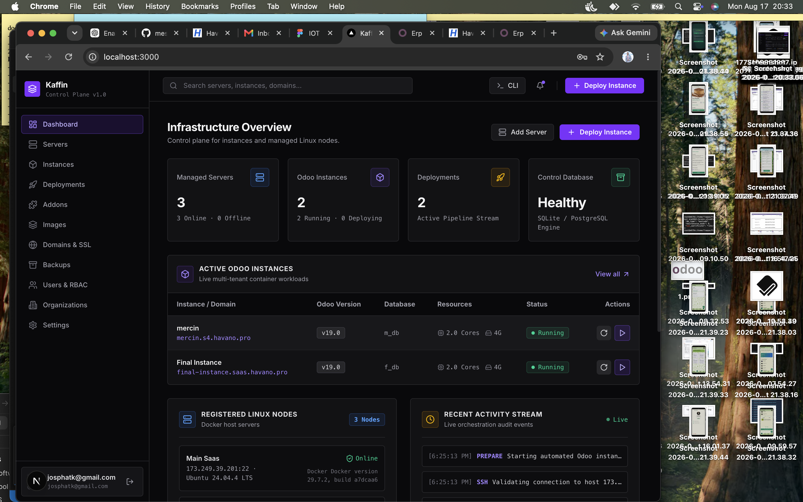
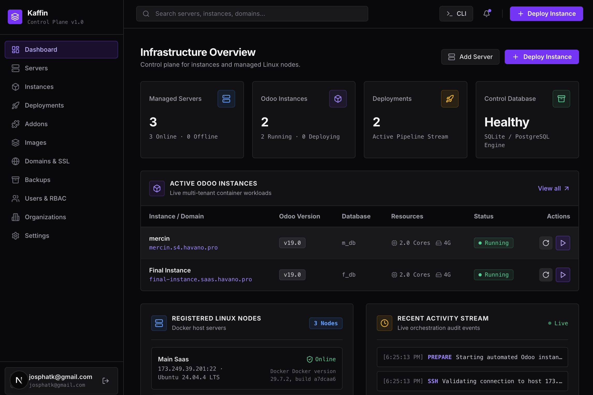
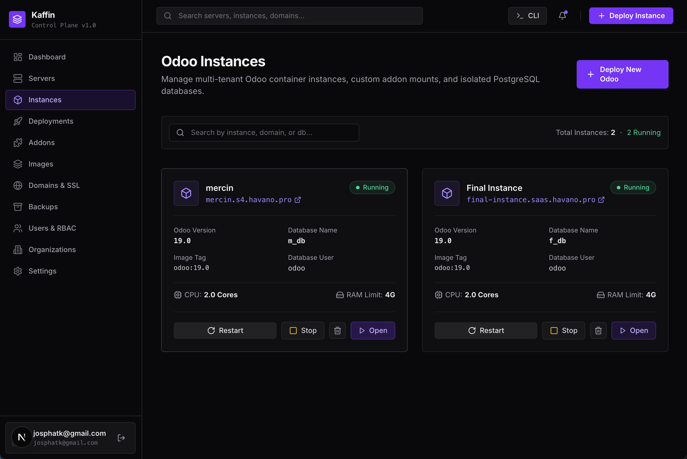

# Kaffin

**Kaffin** is a modern, web-based control plane for orchestrating, provisioning, and managing multi-tenant Odoo installations and isolated PostgreSQL databases across multiple Linux server nodes with Traefik reverse proxy routing and automatic Let's Encrypt SSL/TLS.

---

## 📸 Screenshots & UI Preview

### 1. Instances & Tenant Overview


### 2. Multi-Step Zero-Touch Deployment Wizard
*Automated Database Initialization, Super Admin Credentials, Localization & Subdomain Routing*



### 3. Server Node & Resource Management


---

## 🎬 Video Demo Walkthrough

A live walkthrough showcasing zero-touch Odoo provisioning, automated database initialization, and instant Traefik TLS routing:

👉 **[Watch Walkthrough Video (QuickTime / MOV)](screenshots/demo_walkthrough.mov)**

*(Or download/view [`screenshots/demo_walkthrough.mov`](screenshots/demo_walkthrough.mov) locally)*

---

## 🏗 Architecture Overview

```text
                               USERS
                                 │
                                 ▼
                     ┌───────────────────────┐
                     │   Next.js Frontend    │
                     │ (TypeScript, Tailwind)│
                     └───────────┬───────────┘
                                 │ HTTPS (REST)
                                 ▼
                     ┌───────────────────────┐
                     │  ASP.NET Core Web API │
                     │  (Clean Architecture) │
                     └───────────┬───────────┘
                                 │
             ┌───────────────────┼───────────────────┐
             ▼                   ▼                   ▼
       PostgreSQL             Redis             Hangfire
     (Control Plane DB)                       (Job Queue)
                                                     │
                                                     ▼
                                            Deployment Workers
                                                     │
                                                     ▼ (SSH / Docker)
                                              Managed Servers
                                            (Traefik + Odoo + PG)
```

---

## 📁 Repository Structure

```text
.
├── backend/                  # ASP.NET Core Clean Architecture backend (.NET 10)
│   ├── src/
│   │   ├── OdooDeployer.Api            # REST Controllers & Swagger
│   │   ├── OdooDeployer.Application    # DTOs, interfaces & validation
│   │   ├── OdooDeployer.Domain         # Entities & enums
│   │   ├── OdooDeployer.Infrastructure # SSH Service, Odoo Deployment Engine, EF Core
│   │   └── OdooDeployer.Worker         # Background workers
│   └── tests/
├── frontend/                 # Next.js 16 App Router UI (TypeScript, Tailwind CSS)
├── infrastructure/           # Docker, Traefik, compose templates & scripts
├── screenshots/              # UI screenshots and demo recording
├── docs/                     # Documentation & architectural guides
├── scripts/                  # Development & utility scripts
├── docker-compose.yml        # Local dev infrastructure (PostgreSQL, Redis)
└── GUIDE.md                  # Comprehensive architectural guide
```

---

## 🚀 Quickstart

### 1. Start Infrastructure Dependencies
```bash
docker compose up -d
```

### 2. Run Backend
```bash
cd backend/src/OdooDeployer.Api
dotnet run
```
*API & Swagger documentation will be available at `http://localhost:5000/swagger`.*

### 3. Run Frontend
```bash
cd frontend
npm install
npm run dev
```
*Web dashboard will be available at `http://localhost:3000`.*

